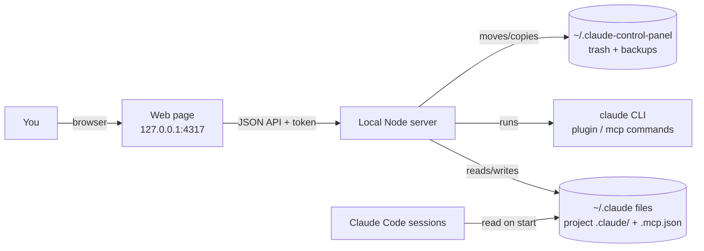

# Claude Code Control Panel — Architecture

Status: **Proposed — awaiting approval** (Phase 3) · Date: 2026-11-01
Based on [REQUIREMENTS.md](REQUIREMENTS.md) and [USER_FLOWS.md](USER_FLOWS.md)

## 1. System context



Everything runs on your PC. Nothing is sent to the internet.

## 2. Components

```
src/
  server.ts          HTTP server: static files + JSON API, token check, 127.0.0.1 bind
  domain/            PURE logic — no files, no processes (easy to unit-test)
    types.ts         Item, Scope, ItemState, Action …
    rules.ts         Which actions an item allows + why not (BR-1…BR-9)
    effective.ts     Resolve effective on/off from several settings files (precedence)
  adapters/          The ONLY code that touches the outside world
    cli.ts           Run `claude …` with argument arrays + timeout; parse output
    files.ts         Read frontmatter; read/merge/atomic-write JSON; backups
    trash.ts         Move to / restore from trash with a manifest
  services/
    inventory.ts     Combine adapters → list of Items with state + allowed actions
    actions.ts       Execute an action: validate → backup → change → re-read → result
public/
  index.html, app.js, styles.css   Plain browser JS, no framework
test/
  domain/*.test.ts   Unit tests (pure rules)
  adapters/*.test.ts Tests against a fake ~/.claude in a temp folder (never your real one)
```

**Why this split:** the risky part of this app is *getting the rules right*: which file to write and
what precedence means. Keeping those rules in `domain/` with no I/O means we can test hundreds of cases in
milliseconds, without touching your real settings. Adapters are thin and tested against temp folders.

## 3. Data flow: example "turn skill X off (user scope)"

1. UI → `POST /api/actions {itemId, action:"disable"}` with header `X-CCP-Token`.
2. Server checks token + `Host`/`Origin` headers → 403 if wrong.
3. `actions.ts` looks up `itemId` in a fresh inventory (never trusts names from the browser).
4. `rules.ts` confirms "disable" is allowed for a standalone user-scope skill → target file `~/.claude/settings.json`.
5. `files.ts`: re-read file → backup copy → set `skillOverrides[X]="off"` → write temp → rename.
6. Re-read inventory → return the item's new state → UI updates.

## 4. API (first draft — detailed in Phase 4)

| Method | Path | Purpose |
|---|---|---|
| GET | `/api/inventory?project=<path>` | All items with state, scope, allowed actions |
| GET | `/api/costs` | Token costs per plugin (slow, cached) |
| GET | `/api/mcp-health` | MCP status (slow) |
| POST | `/api/actions` | `{itemId, action: enable\|disable\|delete\|restore}` |
| GET | `/api/trash` | Trashed items |

## 5. Stack options considered

| | A. Node built-in `http` + TypeScript (native) + plain HTML/JS | B. Express + React (Vite) | C. Desktop app (Electron/Tauri) |
|---|---|---|---|
| Fits requirements | ✔ all | ✔ all | ✔ all |
| Setup / moving parts | Lowest: no build step, ~2 dependencies | Build tooling, more deps | Packaging, signing, IPC |
| Learning value | You see HTTP, files, processes directly | React is valuable but hides basics | Lots of platform-specific concepts |
| UI richness | Enough for tables, switches, dialogs | Easier for complex UIs | Same as B |
| Maintenance | Very small | Medium (dependency updates) | High |

**Recommendation: A.**
- The UI is mostly lists, switches and dialogs, so plain JS is enough.
- Node 24 runs `.ts` files directly (checked on your machine), so we get type safety without a build step.
- You can read every line.
- If the UI outgrows plain JS later, we can add a framework on top; the server and domain code don't change.

**Libraries (proposed):**
- `yaml`: parse skill and agent frontmatter correctly.
- `typescript`, dev only: `tsc --noEmit` for type checking.
- Testing uses Node's built-in `node:test`, so no Jest or Vitest.
- Rejected: Express (not needed for about 5 routes), a database (state already lives in Claude's own files), a frontend framework (see above).

## 6. Security

- **Binding:** the server listens on `127.0.0.1` only.
- **Token:** a random token is generated each run and embedded in the page. Every POST must send it.
- **Host and Origin checks:** both are checked, which defends against DNS-rebinding attacks.
- **Validated actions:** an action only accepts an `itemId` that is in the current inventory. Paths are never taken from the browser.
- **Safe CLI calls:** commands run via `execFile` with an argument array (no shell) and a timeout.
- **Secrets:** never read `.credentials.json` or MCP `env`/`headers` values. They're stripped before anything reaches the UI.
- **Backups:** every settings write first copies the file to `~/.claude-control-panel/backups/<file>.<timestamp>`. The last 50 are kept.

## 7. Logging, ops, deployment

- **Logging:** console output, plus an action log at `~/.claude-control-panel/actions.log` (time, action, item, result). It contains no secrets.
- **Running it:** `npm start`, local only. There's no deployment, hosting or cost.
- **Backup and recovery:** use the timestamped backups and the trash. The README will document how to restore a settings file by hand.

## 8. Technical risks and how we'll check them

| Risk | Check (Phase 4 spike, before building features) |
|---|---|
| `plugin details` / `mcp list` output is plain text that may change between Claude versions | Write parsers against captured samples, add a "couldn't parse — showing raw" fallback, and pin tests to samples |
| `skillOverrides` key: frontmatter `name` vs folder name | Test both on a throwaway skill, then confirm with `/skills` |
| `Agent(name)` deny: frontmatter `name` ("Anthropologist") vs filename | Test with a throwaway agent and check `/agents` |
| Claude Code rewriting settings.json while we write | Re-read just before writing, atomic rename, and a test that writes while the file changes |
| `claude plugin details` is slow ×18 plugins | Run in parallel (limit 4) and cache by plugin id + version |

## 9. First release vs later

**v1:**
- Full inventory with descriptions and token costs, for user scope and project scope
- Plugin on/off and uninstall
- Standalone skill and agent on/off, delete and restore
- MCP view and remove
- Hooks view, plus the "disable all hooks" switch

**Later:**
- MCP on/off
- Turning off individual plugin skills, if Claude Code adds a way
- "Profiles" (e.g. a frontend-work set or a minimal set)
- A desktop shortcut or tray icon
- Comparing cost before and after a change
